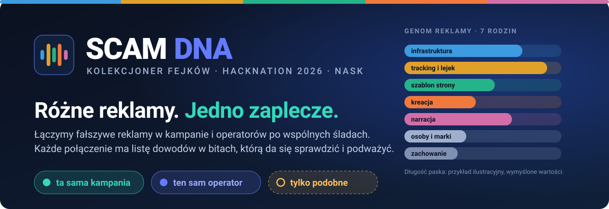
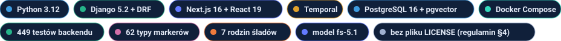
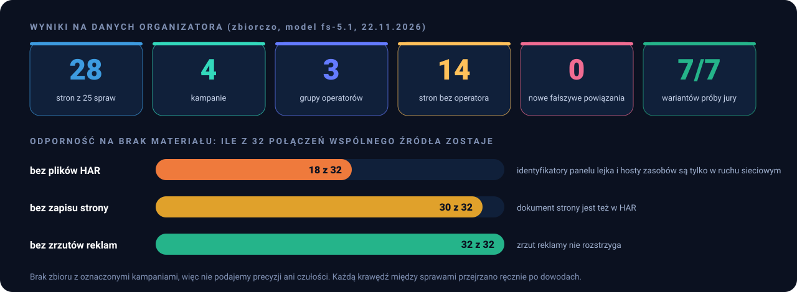
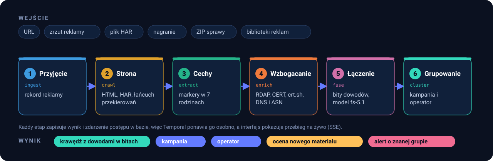
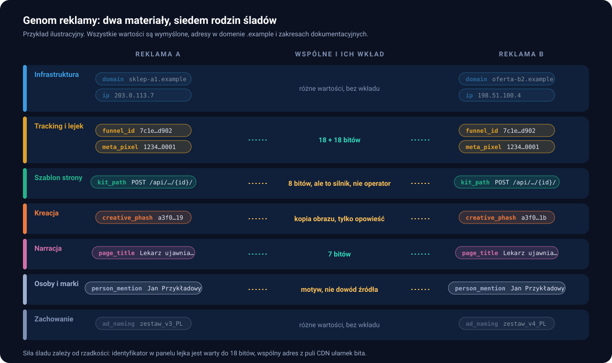
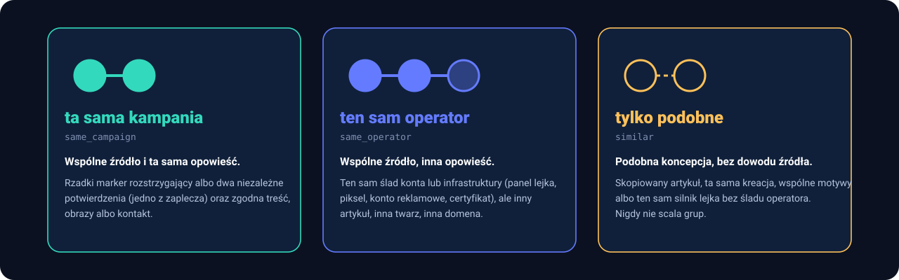
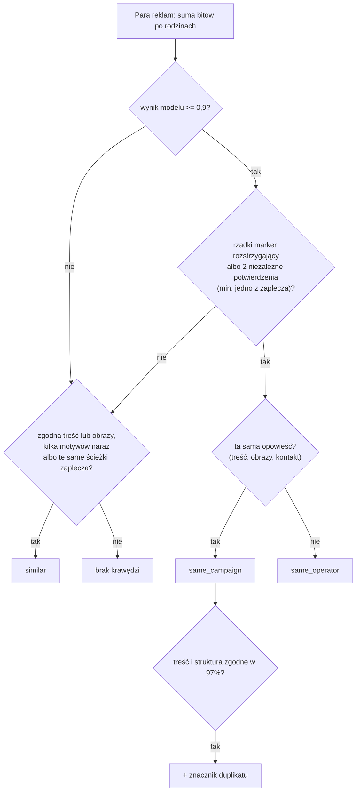
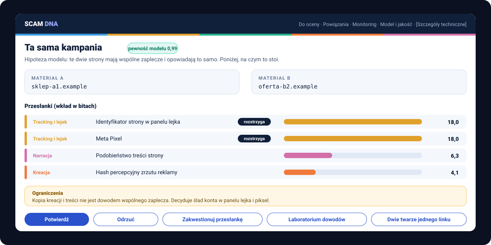
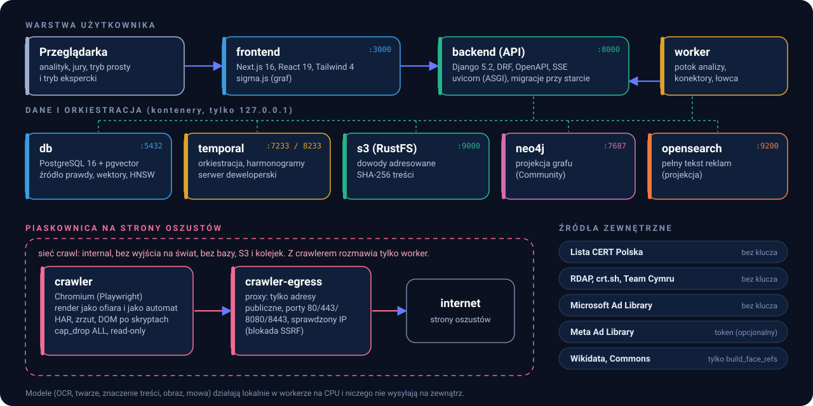

<div align="center">



<br>



<br><br>

**[Problem](#problem-i-pomysł) · [Wyniki](#wyniki-na-danych-organizatora) · [Jak to działa](#jak-to-działa) · [Genom reklamy](#genom-reklamy) · [Metoda](#metoda-od-śladów-do-grup) · [Co wyróżnia](#co-wyróżnia-to-rozwiązanie) · [Interfejs](#interfejs-przegląd-ekranów) · [Funkcje](#pełna-lista-funkcji) · [Architektura](#architektura) · [Start](#szybki-start) · [Testy](#testy-i-jakość) · [Ograniczenia](#ograniczenia-powiedziane-wprost)**

</div>

---

> **SCAM DNA** to demonstrator zadania NASK „Kolekcjoner fejków” (HackNation 2026). Przyjmuje adres, zrzut ekranu, zapisaną stronę, plik HAR, nagranie albo całą sprawę w ZIP-ie, wyciąga z nich **genom reklamy** (62 typy markerów w 7 rodzinach) i łączy pozornie niezależne fałszywe reklamy w **kampanie** i **operatorów**. Każde połączenie ma **listę dowodów z wkładem w bitach**, którą analityk może sprawdzić, podważyć i wyeksportować jako pakiet dowodowy.

## Problem i pomysł

Pojedyncza fałszywa reklama mówi mało. Domena żyje kilka dni, treść się zmienia, twarz celebryty jest wszędzie ta sama, a ten sam artykuł można skopiować na dowolne zaplecze. Pytanie NASK brzmi: **które materiały pochodzą z tego samego źródła i skąd to wiemy**.

Nie oceniamy więc, czy reklama jest oszustwem. Robimy trzy rzeczy:

1. **Zbieramy ślady**, których oszust nie zmienia przy każdej nowej domenie: identyfikator strony w panelu lejka, piksel, konto reklamowe, certyfikat, ścieżki zaplecza strony, kanał kontaktu.
2. **Ważymy je rzadkością.** Adres z puli Cloudflare jest wart ułamek bita, identyfikator konta w panelu lejka do 18 bitów.
3. **Łączymy tylko wtedy, gdy jest na czym.** Skopiowana treść, ta sama twarz celebryty albo kupiony silnik lejka nie sklejają różnych operatorów. To jest relacja „podobne”, a nie „ten sam operator”.

## Wyniki na danych organizatora



Silnik nie dostał żadnej informacji, które sprawy do siebie pasują. Z 28 stron z 25 spraw złożył 4 kampanie i 3 grupy operatorów, a 14 stron zostawił bez operatora, bo nie było dowodu wspólnego zaplecza. Każdą krawędź między sprawami przejrzeliśmy ręcznie po dowodach.

- **Brak materiału nie tworzy fałszywych połączeń.** Bez plików HAR zostaje 18 z 32 połączeń wspólnego źródła, bez zapisu strony 30, bez zrzutów reklam 32, a w żadnym wariancie nie powstało połączenie, którego nie było w pełnym imporcie.
- **Próba jury „spróbuj zgubić kampanię”**: 7 z 7 przebranych wariantów (przycięty i przekompresowany zrzut, podmienione zdania, nowa domena) wróciło do swojej kampanii i operatora. Kopia zrzutu i tekstu na obcej infrastrukturze dała tylko „podobne”.
- **Wrażliwość na wagi**: zmiana siły dowodów o ±50% rusza tylko 4 pary graniczne, szansa wstępna i próg pewności nie zmieniają żadnej relacji.

Szczegóły, metoda pomiaru i polecenia do powtórzenia: [docs/dane-organizatora.md](docs/dane-organizatora.md). Surowych danych organizatora w repozytorium nie ma (leżą lokalnie w `data/raw/`, poza gitem), a ten plik jest jedynym miejscem z domenami ze spraw, dlatego **repozytorium ma pozostać prywatne**.

> **Czego nie twierdzimy.** Nie mamy zbioru z oznaczonymi kampaniami, więc **nie podajemy precyzji ani czułości**. „Pewność” przy krawędzi to niekalibrowany wynik modelu, nie prawdopodobieństwo. Pełna lista ograniczeń: [sekcja niżej](#ograniczenia-powiedziane-wprost).

## Jak to działa



Potok (`backend/workflows/pipeline.py`) ma sześć etapów: `ingest`, `crawl`, `extract`, `enrich`, `fuse`, `cluster`. Każdy zapisuje wynik i zdarzenie postępu w bazie, więc Temporal ponawia go osobno, a interfejs pokazuje przebieg na żywo przez SSE.

| Etap | Co się dzieje |
|---|---|
| 1. Przyjęcie | rekord reklamy, normalizacja wejścia, adresy po redakcji tokenów |
| 2. Strona | materiał z przechwycenia: HTML i HAR z plików, **bez żadnego ruchu do sieci**. Adres na żywo: crawler z przeglądarką w piaskownicy pobiera stronę jako automat i jako ofiara z telefonu, zapisuje HAR, zrzut i łańcuch przekierowań (w tym skoki skryptowe) |
| 3. Cechy | ekstraktory: URL, HAR, HTML, obrazy, OCR, twarze, nagrania, mowa, znaczenie tekstu i obrazu, słowa kluczowe, osoby |
| 4. Wzbogacanie | RDAP, Lista Ostrzeżeń CERT Polska, certyfikaty z crt.sh (do 50 najnowszych), dla stron na żywo także DNS, ASN, certyfikat TLS i favicon |
| 5. Łączenie | kandydaci z indeksu (twarde markery i pasma LSH, najwyżej 500), model par Fellegi-Sunter, krawędź z dowodami |
| 6. Grupowanie | kampania i operator jako składowe spójne po krawędziach, ocena nowego materiału, alert, gdy reklama dołączyła do znanej grupy |

**Brak danych nie zatrzymuje analizy.** Strona niedostępna, sprawa bez HAR albo sam zrzut ekranu dają mniej cech, a nie błąd. Reklamy bez strony docelowej (formularze w Facebooku) łączymy po kreacji, narracji i osobach.

### Skąd biorą się ślady

| Materiał | Co z niego wyciągamy |
|---|---|
| Adres URL | domena, szablon ścieżki, zestaw parametrów, piksele i klucze afiliacyjne w parametrach, identyfikatory reklam Meta, nazewnictwo zestawów reklam, ślad cyrylicy |
| HAR | łańcuch przekierowań, ścieżki zaplecza strony (odcisk silnika lejka), hosty zasobów i trackerów, identyfikatory z żądań POST, adres IP z chwili przechwycenia, sygnatura serwera |
| HTML | identyfikatory śledzące, kontakty, formularze, tytuł, treść (MinHash), struktura DOM, podszycie pod markę, wzmianki o osobach, słowa kluczowe, tematyka |
| Zrzut ekranu reklamy | OCR (nazwa reklamodawcy, tekst, numer z Biblioteki Reklam Mety), hash percepcyjny kreacji, wektor obrazu, twarze |
| Obrazy strony | zbiór haszy percepcyjnych: te same zdjęcia na różnych domenach |
| Nagranie reklamy | 8 klatek (hash, OCR, twarze), mowa zamieniona na tekst lokalnym modelem Whisper |
| Archiwum NASK | adres IP i numer seryjny certyfikatu z `dns_ssl.json` |
| Strona na żywo | DNS, ASN, certyfikat TLS, favicon, RDAP, różnica między stroną dla bota i dla ofiary |
| Lista Ostrzeżeń CERT Polska | etykieta: czy domena jest na liście i od kiedy |

Tokeny dostępu znalezione w adresach zapisujemy **wyłącznie jako skrót SHA-256**.

## Genom reklamy



Każdy ślad to **marker**: typ i znormalizowana wartość. Rejestr 62 typów z siłą dowodową jest w jednym miejscu: [`backend/evidence/kinds.py`](backend/evidence/kinds.py) (57 typów niesie dowód, 5 to klucze wyszukiwania LSH; 22 typy są „rozstrzygające”, 7 to markery miękkie porównywane przez podobieństwo).

| Rodzina | Typów | Przykłady | Skąd |
|---|---|---|---|
| **Infrastruktura** | 14 | domena, domeny w łańcuchu przekierowań, IP, ASN, certyfikat TLS (skrót i numer seryjny), favicon, rejestrator, dzień rejestracji, szablon ścieżki URL | URL, HAR, RDAP, DNS, crt.sh |
| **Tracking i lejek** | 13 | GA4, GTM, Meta Pixel, Google Ads, Yandex Metrica, TikTok Pixel, token Conversions API (skrót), **identyfikator strony w panelu lejka**, endpoint formularza, hosty zasobów | HTML, treść skryptów i żądań w HAR |
| **Szablon strony** | 5 | **ścieżki zaplecza strony**, hash struktury DOM, podobieństwo DOM (MinHash), „biała strona” cloakingu | HAR, HTML |
| **Kreacja** | 7 | hash percepcyjny zrzutu, zbiór obrazów strony, wspólne klatki nagrania, **podobne ujęcie (CLIP)** | zrzuty, obrazy z HAR, klatki |
| **Narracja** | 14 | telefon, e-mail, Telegram, WhatsApp, adresy BTC i ETH, IBAN, tytuł, podobieństwo treści i **znaczenia treści** (model wielojęzyczny), tematyka | HTML, OCR, mowa |
| **Osoby i marki** | 7 | wzmianka o osobie (z odmianą), **twarz z bazy referencyjnej**, podszycie pod markę, strona reklamodawcy, płatnik, identyfikator reklamy Meta | tekst, OCR, twarze, biblioteki reklam |
| **Zachowanie** | 2 | nazewnictwo reklam i zestawów, ślad językowy operatora | parametry URL, źródło strony |

<details>
<summary><b>Pełny katalog 62 typów markerów</b> (kod, opis, typ, limit wkładu, czy rozstrzyga)</summary>

**Infrastruktura** (14)

| Kod | Co to jest | Typ | Maks. wkład (bity) | Rozstrzyga |
|---|---|---|---|---|
| `domain` | Domena | twardy | 18 | tak |
| `redirect_domain` | Domena w łańcuchu przekierowań | twardy | 10 |  |
| `ip` | Adres IP | twardy | 6 |  |
| `asn` | System autonomiczny | twardy | 1,5 |  |
| `nameserver` | Serwer nazw | twardy | 2 |  |
| `tls_fp` | Certyfikat TLS | twardy | 16 | tak |
| `tls_serial` | Numer seryjny certyfikatu | twardy | 16 | tak |
| `favicon_hash` | Hash favicony | twardy | 8 |  |
| `registrar` | Rejestrator | twardy | 1 |  |
| `reg_day` | Dzień rejestracji domeny | twardy | 2 |  |
| `url_path_tpl` | Szablon ścieżki URL | twardy | 4 |  |
| `url_param_keys` | Zestaw parametrów URL | twardy | 4 |  |
| `cdn` | Sieć CDN | twardy | 0,5 |  |
| `server_sig` | Sygnatura serwera | twardy | 1,5 |  |

**Tracking i lejek** (13)

| Kod | Co to jest | Typ | Maks. wkład (bity) | Rozstrzyga |
|---|---|---|---|---|
| `ga4` | Google Analytics 4 | twardy | 18 | tak |
| `ga_ua` | Google Analytics UA | twardy | 18 | tak |
| `gtm` | Google Tag Manager | twardy | 18 | tak |
| `meta_pixel` | Meta Pixel | twardy | 18 | tak |
| `yandex_metrica` | Yandex Metrica | twardy | 18 | tak |
| `tiktok_pixel` | TikTok Pixel | twardy | 18 | tak |
| `form_action` | Endpoint formularza leadów | twardy | 16 | tak |
| `script_host` | Host skryptu zewnętrznego | twardy | 2 |  |
| `google_ads` | Konto Google Ads | twardy | 18 | tak |
| `capi_token` | Token Meta Conversions API (skrót) | twardy | 18 | tak |
| `funnel_id` | Identyfikator strony w panelu lejka | twardy | 18 | tak |
| `funnel_param` | Klucz afiliacyjny lub parametr lejka | twardy | 12 |  |
| `asset_host` | Host zasobów lub trackera | twardy | 9 |  |

**Szablon strony** (5)

| Kod | Co to jest | Typ | Maks. wkład (bity) | Rozstrzyga |
|---|---|---|---|---|
| `dom_hash` | Hash struktury DOM | twardy | 10 |  |
| `white_dom_hash` | Hash białej strony cloakingu | twardy | 8 |  |
| `kit_path` | Ścieżka zaplecza strony | twardy | 8 |  |
| `dom_band` | Pasmo LSH szablonu | klucz wyszukiwania | 0 |  |
| `dom_minhash` | Podobieństwo szablonu | miękki | 7 |  |

**Kreacja** (7)

| Kod | Co to jest | Typ | Maks. wkład (bity) | Rozstrzyga |
|---|---|---|---|---|
| `creative_sha256` | Plik kreacji | twardy | 9 |  |
| `creative_phash` | Hash percepcyjny zrzutu reklamy | twardy | 12 |  |
| `image_band` | Klucz wyszukiwania obrazów | klucz wyszukiwania | 0 |  |
| `image_set` | Wspólne obrazy na stronie | miękki | 7 |  |
| `video_band` | Klucz wyszukiwania klatek nagrania | klucz wyszukiwania | 0 |  |
| `video_frames` | Wspólne klatki nagrania reklamy | miękki | 10 |  |
| `image_embedding` | Podobne ujęcie obrazu reklamy | miękki | 5 |  |

**Narracja** (14)

| Kod | Co to jest | Typ | Maks. wkład (bity) | Rozstrzyga |
|---|---|---|---|---|
| `phone` | Telefon | twardy | 18 | tak |
| `email` | E-mail | twardy | 18 | tak |
| `telegram` | Telegram | twardy | 18 | tak |
| `whatsapp` | WhatsApp | twardy | 18 | tak |
| `crypto_btc` | Adres Bitcoin | twardy | 18 | tak |
| `crypto_eth` | Adres Ethereum | twardy | 18 | tak |
| `iban` | Rachunek bankowy | twardy | 18 | tak |
| `page_title` | Tytuł strony | twardy | 7 |  |
| `page_text_band` | Pasmo LSH treści strony | klucz wyszukiwania | 0 |  |
| `page_text_minhash` | Podobieństwo treści strony | miękki | 8 |  |
| `text_embedding` | Podobieństwo znaczenia treści | miękki | 5 |  |
| `topic` | Tematyka | twardy | 1,5 |  |
| `text_band` | Pasmo LSH tekstu | klucz wyszukiwania | 0 |  |
| `text_minhash` | Podobieństwo tekstu | miękki | 6 |  |

**Osoby i marki** (7)

| Kod | Co to jest | Typ | Maks. wkład (bity) | Rozstrzyga |
|---|---|---|---|---|
| `advertiser_id` | Strona reklamodawcy | twardy | 18 | tak |
| `payer` | Płatnik reklamy | twardy | 9 |  |
| `person_mention` | Wzmianka o osobie | twardy | 2,5 |  |
| `meta_ad_ref` | Identyfikator reklamy lub kampanii Meta | twardy | 18 | tak |
| `page_name` | Nazwa strony lub reklamodawcy | twardy | 8 |  |
| `brand_impersonated` | Podszycie pod markę | twardy | 3 |  |
| `face_match` | Twarz osoby z bazy referencyjnej | twardy | 2,5 |  |

**Zachowanie** (2)

| Kod | Co to jest | Typ | Maks. wkład (bity) | Rozstrzyga |
|---|---|---|---|---|
| `ad_naming` | Nazewnictwo reklam i zestawów | twardy | 8 |  |
| `lang_trace` | Ślad językowy operatora | twardy | 1,5 |  |

Limit wkładu to `cap`: największa liczba bitów, jaką może wnieść jeden ślad. Pełne parametry modelu (`m`, `f0`) są w kodzie, opis w [docs/metodyka.md](docs/metodyka.md), a zapis zwracany przez API w `GET /api/kinds` i `GET /api/weights`.

</details>

## Metoda: od śladów do grup

### 1. Waga śladu w bitach

Model **Fellegi-Sunter z ważeniem rzadkością** (`backend/similarity/fusion.py`, wersja `fs-5.1`). Dla wspólnego markera twardego:

```
waga = log2( m / f ),  ograniczona do [0, cap]
f = (źródła_z_tą_wartością - 2 + α·f0) / (wszystkie_źródła - 2 + α),  α = 1000
```

`m` to szansa, że dwie reklamy tej samej kampanii zgadzają się na tym typie śladu, `f` to jak pospolita jest wartość w korpusie (wygładzona częstością bazową typu `f0`). Marker miękki dostaje wagę rosnącą liniowo między progami `lo` i `hi`. Markery jednej rodziny idą zwykle w parze, więc w rodzinie pełną wagę ma najsilniejszy, drugi połowę, trzeci ćwierć. **Rzadkość liczymy po niezależnych źródłach, nie po reklamach**, żeby identyfikator dużej kampanii nie wyglądał na pospolity.

### 2. Od bitów do relacji

Sama wysoka suma nie wystarcza. Wspólne źródło wymaga **rzadkiego markera rozstrzygającego** albo **dwóch niezależnych silnych potwierdzeń, z których co najmniej jedno dotyczy zaplecza**.





Dlaczego tak ostrożnie (reguły mają testy w `backend/tests/`):

- **Treść i obrazy da się skopiować.** Ten sam artykuł na dwóch zapleczach to `similar`.
- **Kopia kreacji to pokrewieństwo treści, nie zaplecze.** Kontakty (telefon, e-mail, Telegram, krypto, IBAN) zostają rozstrzygające: tam ofiara ma zapłacić.
- **Silnik lejka to program, nie operator.** Ścieżki zaplecza i szablon ścieżki ustawia ten sam silnik, więc liczą się jako jedno potwierdzenie. Operatora wskazuje dopiero ślad konta: identyfikator w panelu, piksel, konto reklamowe, własny host zasobów, certyfikat.
- **Motyw nie potwierdza źródła.** Osoba, marka i tematyka dodają bity, ale nie są niezależnym potwierdzeniem, nawet kilka naraz.
- **Huby.** Marker obecny w ponad 1% źródeł (minimum 100) nie służy do szukania kandydatów.

### 3. Grupowanie bez efektu łańcucha

- **Kampania** to składowa spójna grafu po krawędziach `same_campaign`.
- **Operator** to składowa spójna po `same_campaign` i `same_operator`.
- `similar` **nigdy niczego nie spina**, a każda krawędź grupująca przeszła regułę z punktu 2. Nie ma łączenia po samym progu podobieństwa, więc nie ma łańcuchów.
- Krawędź odrzucona przez analityka niczego nie spina: `recluster` rozdziela grupę po nieodrzuconych krawędziach, a cofnięcie odrzucenia scala ją z powrotem.

### 4. Ocena nowego materiału

Nowa reklama nie jest porównywana z całym korpusem. Kandydatów daje indeks (markery twarde, pasma LSH, indeksy HNSW wektorów w pgvector), najwyżej 500. Wynik:

| Ocena | Znaczenie |
|---|---|
| `duplicate` | ten materiał już jest w korpusie |
| `known_campaign` | nowa odsłona znanej kampanii |
| `known_operator` | nowa kampania znanego operatora |
| `similar_only` | podobna koncepcja, brak dowodu wspólnego źródła |
| `new_pattern` | brak powiązań, potencjalnie nowa kampania |

Dołączenie do znanej grupy tworzy **alert** z trzema najmocniejszymi dowodami.

### 5. Wagi eksperckie i uczone

Domyślnie działają wagi eksperckie. `manage.py estimate_weights` szacuje wagi metodą EM bez etykiet (dwie klasy: zaplecze i opowieść), `MODEL_WEIGHTS=learned` je włącza (wersja `fs-6`), a `GET /api/weights` i ekran „Wagi markerów” pokazują obie wersje obok siebie. Na 28 reklamach organizatora uczone dają to samo grupowanie, ale na korpusie z reklamami Microsoft łamią rdzeń operatora A, więc nie są domyślne. Kalibracja logistyczna na decyzjach analityków jest policzona, ale nie jest stosowana: decyzji jest 0.

Pełny opis metody: [docs/metodyka.md](docs/metodyka.md).

## Co wyróżnia to rozwiązanie

| Funkcja | Po co | Gdzie |
|---|---|---|
| **Zakwestionuj przesłankę** | Identyfikator może należeć do pośrednika, a piksel do wspólnego panelu. Podgląd pokazuje, które grupy się rozpadną, a które trzymają się na innych, niezależnych śladach. Zapis przelicza krawędzie i grupy w całym korpusie, przywrócenie to cofa, historia zostaje | `POST /api/premises/preview`, `POST /api/premises`, `.../restore`, ekran „Zakwestionowania” |
| **Laboratorium dowodów** | Wyłącza wybrane ślady na próbę i pokazuje, czy połączenie się utrzymuje. Niczego nie zapisuje | `POST /api/edges/{id}/simulate`, [docs/laboratorium.md](docs/laboratorium.md) |
| **Test najsłabszego ogniwa** | Najmniejsze zestawy grup śladów, których utrata zmienia relację: pokazuje, na czym połączenie „wisi” | `POST /api/edges/{id}/weakest-link` |
| **Co sprawdzić dalej** | Z brakujących dowodów danej pary: jakiej cechy brakuje do mocniejszej relacji | `GET /api/edges/{id}/suggestions` |
| **Dwie twarze jednego linku** | Ten sam adres, dwie różne strony (cloaking albo jednorazowy token): porównanie obserwacji obok siebie, tylko do odczytu | `GET /api/observations/compare`, [docs/dwie-twarze.md](docs/dwie-twarze.md) |
| **Uczciwe „podobne ≠ ten sam operator”** | System nie dopisuje do operatora stron, które mają tylko skopiowaną treść, kreację albo wspólny silnik lejka | [reguły w metodyce](docs/metodyka.md) |
| **Kolejka „Do oceny”** | Pary bez werdyktu z powodem uwagi (zakwestionowany ślad, zmiana po decyzji, relacja bez śladu zaplecza, wynik na granicy, nowa reklama w znanej grupie), hipoteza modelu osobno od oceny, zdania o tym, czego krawędź nie dowodzi | `GET /api/review` |
| **Pamięć sprzeciwu** | Decyzja analityka z powodem wraca jako precedens przy podobnej parze. Opcjonalny adapter Jev jest osobną, domyślnie wyłączoną warstwą | `GET /api/edges/{id}/precedents`, [docs/pamiec-sprzeciwu.md](docs/pamiec-sprzeciwu.md), [docs/jev.md](docs/jev.md) |
| **Pakiet dowodowy** | Jeden ZIP operatora lub kampanii: `raport.html` do druku, artefakty adresowane SHA-256, `manifest.json`, `SHA256SUMS`, `stix.json`, `krawedzie.jsonl`, `os-czasu.json` i `weryfikuj.py`, który sprawdza sumy bez naszego systemu | `GET /api/operators/{id}/package`, `GET /api/campaigns/{id}/package` |
| **Eksport STIX 2.1 i korpusu** | Operator jako `intrusion-set`, kampania jako `campaign`, wskaźniki dla domen, IP i numerów certyfikatów; ZIP z wzbogaconym korpusem (reklamy z markerami, krawędzie z dowodami, grupy) | `GET /api/export/stix`, `GET /api/export`, `manage.py export_corpus` |
| **Łowca domen** | Nowe domeny znanych operatorów z logów Certificate Transparency (crt.sh) i Listy CERT, **zanim pojawi się reklama**. Wynik wstępny z nazwy, potwierdzenie crawlerem śladami operatora z wynikiem w bitach, alert `hunt_confirmed` | `manage.py hunt`, `GET /api/hunt`, ekran „Łowca domen” |
| **Alerty** | Nowa reklama w znanej kampanii albo u znanego operatora, potwierdzona domena z łowcy | `GET /api/alerts`, ekran „Alerty” |
| **Podsumowanie HAR** | Plik HAR czytelny dla analityka: lista żądań, łańcuch przekierowań, żądania ze śladami, adresy po redakcji, bez treści. Surowy plik jako drugi odnośnik | `GET /api/artifacts/{sha}/har`, okno w karcie reklamy |
| **Wagi na ekranie** | Siła każdego śladu, wagi eksperckie obok uczonych | `GET /api/weights`, ekran „Wagi markerów” |
| **Tryb prosty i ekspercki** | Start w trybie prostym: wnioski prostym językiem, bez bitów i identyfikatorów. Przełącznik „Szczegóły techniczne” pokazuje pełne dane | `frontend/src/lib/expert.tsx` |

## Interfejs: przegląd ekranów



*Schemat ekranu powiązania narysowany od zera, z wymyślonymi wartościami. Zrzuty prawdziwego interfejsu zawierają dane organizatora, więc nie leżą w repozytorium i są pokazywane tylko jury (prezentacja i nagranie demo).*

Interfejs (`frontend/`, Next.js 16) niczego nie liczy sam, a każda wartość na ekranie pochodzi z API. Ekran bez API jest oznaczony jako niedostępny, nic nie jest zmyślone.

| Ekran | Ścieżka | Co robi |
|---|---|---|
| **Do oceny** | `/review` | kolejka par z powodem uwagi, stanowisko oceny: hipoteza modelu, materiały A i B obok siebie, przesłanki z ograniczeniami, decyzja (potwierdź, odrzuć, niepewne) przypięta do wersji dowodów, zakwestionowanie przesłanki, laboratorium |
| **Analiza** (Discovery) | `/` | adres, tekst albo pliki (zrzut, HAR, nagranie, ZIP sprawy), przebieg etapów na żywo, wynik: ocena nowego materiału i najmocniejsze dowody |
| **Śledztwo** | `/investigation` | graf sąsiedztwa reklam, kampanii i operatorów (sigma.js), lista powiązań, panel dowodów z wkładem rodzin |
| **Kampanie, Operatorzy** | `/campaigns`, `/operators` (+ karty szczegółów) | grupy z miniaturami, „Dlaczego razem” w bitach, oś obserwacji, pakiet dowodowy (ZIP) |
| **Archiwum, karta reklamy** | `/archive`, `/ads/{id}` | wszystkie reklamy, genom reklamy po rodzinach, zrzuty z powiększeniem (lightbox), podsumowanie HAR, nagrania, obserwacje strony |
| **Alerty** | `/alerts` | nowe materiały w znanych grupach |
| **Łowca domen** | `/hunt` | kandydaci z logów CT i Listy CERT, wynik wstępny, potwierdzenia, uruchomienie przebiegu, zgłoszenie do pełnej analizy |
| **Wagi markerów** | `/weights` | siła poszczególnych śladów, wagi eksperckie i uczone |
| **Zakwestionowania** | `/premises` | historia zakwestionowanych przesłanek ze stanem przed, po i po przywróceniu |

**Telefon i wąskie okna.** Układ jest responsywny: na telefonie boczny pasek zamienia się w dolną nawigację z czterema najczęstszymi miejscami (Do oceny, Analiza, Śledztwo, Alerty) i menu „Więcej”. **Marka:** granat `#10203A`, kobalt `#2952CC`, pięć kolorów pasm genomu (znak i favicon rysują te same pasma), cienki pasek pięciu kolorów u góry. Kolory rodzin śladów są stałe na każdym ekranie.

## Pełna lista funkcji

Mapa funkcji na wymagania organizatora (pkt 3 i 4 opisu zadania) i pięć kryteriów oceny: **M** metoda korelacji i grupowania (30%), **C** użyteczność i trafność cech i źródeł (30%), **D** kompletność demonstratora end-to-end (15%), **I** czytelność i interpretowalność powiązań (15%), **W** potencjał wdrożeniowy, skalowalność, przenośność (10%). Pełna tabela zgodności ze stanem każdego wymagania: [docs/wymagania.md](docs/wymagania.md).

| Funkcja | Wymóg organizatora | Kryterium | Kod | Dokument |
|---|---|---|---|---|
| Wejście: URL, tekst, zrzut, HAR, wideo, ZIP, archiwum NASK, `page-capture` | przyjmuje URL, zrzut, log komunikacji, plik multimedialny, dane ze zbioru | D | `collectors/bundle.py`, `api/views.py` | [metodyka §2](docs/metodyka.md) |
| 62 typy markerów w 7 rodzinach | zestaw cech do porównywania | C | `evidence/kinds.py`, `extractors/` | [metodyka §4](docs/metodyka.md) |
| Domeny, przekierowania, struktura stron, ścieżki zaplecza | domeny, linki, struktura stron | C | `extractors/url.py`, `har.py`, `html.py` | [metodyka §4](docs/metodyka.md) |
| Tekst, słowa kluczowe, tematyka, znaczenie treści (model wielojęzyczny) | tekst, słowa kluczowe, tematyka | C | `extractors/text.py`, `keywords.py`, `embedding.py` | [metodyka §4](docs/metodyka.md) |
| OCR zrzutów reklam (PP-OCRv5, lokalnie) | zrzut ekranu | C, D | `extractors/ocr.py` | [licencje](docs/licencje.md) |
| Hash percepcyjny i podobne ujęcie (CLIP) | cechy wizualne | C | `extractors/images.py`, `image_embedding.py` | [metodyka §4](docs/metodyka.md) |
| Twarze z małej bazy referencyjnej (YuNet, SFace), wzmianki o osobach | wizerunki osób | C | `people/faces.py`, `matching.py` | [licencje](docs/licencje.md) |
| Nagrania: 8 klatek (hash, OCR, twarze), mowa na tekst (Whisper lokalnie) | plik multimedialny | C | `extractors/video.py`, `speech.py` | [metodyka §12](docs/metodyka.md) |
| Publiczne metadane: RDAP, crt.sh, Team Cymru, Lista CERT Polska | publiczne metadane domen i infrastruktury | C | `enrichment/`, `collectors/cert_pl.py` | [metodyka §10](docs/metodyka.md) |
| Model Fellegi-Sunter z ważeniem rzadkością, wersja `fs-5.1` | metoda podobieństwa | M | `similarity/fusion.py` | [metodyka §5](docs/metodyka.md) |
| Trzy relacje, reguła rozstrzygających markerów, duplikaty | duplikaty, warianty, grupy podobnych kampanii | M | `similarity/service.py` | [metodyka §6](docs/metodyka.md) |
| Kampanie i operatorzy bez łańcuchów, `recluster` | grupowanie w kampanie | M | `similarity/service.py` | [metodyka §7](docs/metodyka.md) |
| Ocena nowego materiału, alerty | analiza nowego materiału względem zbioru | M, D | `similarity/alerts.py` | [metodyka §8](docs/metodyka.md) |
| Wagi uczone EM, wrażliwość na wagi | metoda | M | `similarity/learning.py`, `weight_sensitivity` | [metodyka §5](docs/metodyka.md) |
| Dowody przy każdej krawędzi, wkład w bitach | wskazanie cech i przesłanek | I | `EdgeEvidence`, `GET /api/edges/{id}` | [metodyka §9](docs/metodyka.md) |
| Zakwestionowanie przesłanki, laboratorium, najsłabsze ogniwo | czytelność i weryfikowalność | I | `similarity/premises.py`, `simulation.py`, `weakest.py` | [laboratorium](docs/laboratorium.md) |
| Dwie twarze jednego linku | czytelność, niekompletne dane | I | `similarity/observations.py` | [dwie-twarze](docs/dwie-twarze.md) |
| Graf, listy, karty, genom, lightbox, podsumowanie HAR | prezentacja zależności | I, D | `frontend/src/components/` | [api.md](docs/api.md) |
| Prosty interfejs, tryb prosty i ekspercki, responsywny | prosty interfejs graficzny | D, I | `frontend/src/app/` | [frontend/AGENTS.md](frontend/AGENTS.md) |
| Pakiet dowodowy, STIX 2.1, eksport korpusu | wzbogacony zbiór danych | I, W | `similarity/package.py`, `stix.py` | [api.md](docs/api.md#pakiet-dowodowy) |
| Biblioteki reklam: Microsoft (bez klucza), Meta (z tokenem), Lista CERT | automatyczne wyszukiwanie w bibliotekach | C, W | `collectors/` | [licencje](docs/licencje.md) |
| Harmonogramy Temporala, wstrzymywane na demo | okresowa aktualizacja | W | `ensure_schedules.py` | [prezentacja](docs/prezentacja.md) |
| Łowca domen | rozpoznawanie nowych wariantów | C, M | `hunting/` | [metodyka §8a](docs/metodyka.md) |
| Crawler w piaskownicy (sieć wewnętrzna, proxy wyjściowe) | pobieranie bez narażania hosta | W | `crawler/`, `docker-compose.yml` | [crawler.md](docs/crawler.md) |
| Całość w Dockerze, instalacja jednym poleceniem | skonteneryzowane środowisko, instrukcja | W, D | `scripts/start.py`, `docker-compose.yml` | [Szybki start](#szybki-start) |
| Bezpieczeństwo API: Origin, klucz zapisu, limity, SSRF | opis dostępu do usług | W | `api/security.py` | [bezpieczenstwo.md](docs/bezpieczenstwo.md) |
| Lista bibliotek, modeli i usług z licencjami | wymóg formalny | W | | [licencje.md](docs/licencje.md) |

## Architektura



| Usługa | Obraz lub technologia | Rola | Port na hoście |
|---|---|---|---|
| `frontend` | Next.js 16, React 19, TypeScript, Tailwind 4 | interfejs | 3000 |
| `backend` | Django 5.2, DRF, drf-spectacular, uvicorn (ASGI) | API REST i SSE, migracje przy starcie | 8000 |
| `worker` | ten sam obraz co backend, `temporalio` | potok analizy, konektory, łowca | brak |
| `temporal` | `temporalio/temporal` (serwer deweloperski) | orkiestracja, harmonogramy | 7233, UI 8233 |
| `db` | `pgvector/pgvector:pg16` | źródło prawdy, wektory, indeksy HNSW | 5432 |
| `s3` | `rustfs/rustfs` | magazyn dowodów adresowanych hashem treści | 9000, konsola 9001 |
| `neo4j` | `neo4j:5-community` | projekcja grafu (`manage.py project_graph`) | 7474, 7687 |
| `opensearch` | `opensearchproject/opensearch:2` | indeks pełnotekstowy (`manage.py index_ads`) | 9200 |
| `crawler` | Playwright + Chromium | render stron oszustów, HAR, zrzut | brak (sieć wewnętrzna) |
| `crawler-egress` | ten sam obraz, tryb proxy | jedyne wyjście crawlera na zewnątrz | brak |

Rdzeń (analiza, łączenie, API) potrzebuje tylko PostgreSQL, Temporala i magazynu S3. Neo4j i OpenSearch to projekcje, które da się odbudować z Postgresa. `ANALYSIS_RUNNER=thread` pozwala pracować bez Temporala, a `ARTIFACT_BACKEND=local` bez S3.

**Skalowalność i przenośność.** Kandydatów szukamy indeksem (twarde markery, pasma LSH, HNSW), a nie porównaniem ze wszystkimi, więc koszt jednej reklamy nie rośnie liniowo z korpusem. Każdy etap potoku zapisuje wynik, więc Temporal ponawia go osobno. Jeden obraz backendu obsługuje API i workery. Całość działa na Windowsie i Linuksie z samym Dockerem (macOS: nie sprawdzaliśmy), a modele działają lokalnie na CPU.

<details>
<summary><b>Struktura repozytorium</b></summary>

| Katalog | Zawartość |
|---|---|
| `backend/extractors/` | cechy z URL, HTML, HAR, obrazów, tekstu, OCR, nagrań, mowy, wektorów |
| `backend/evidence/kinds.py` | rejestr typów markerów i ich siła dowodowa |
| `backend/similarity/` | model par (`fusion.py`), łączenie i grupowanie (`service.py`), uczenie wag, laboratorium, przesłanki, pakiet dowodowy, STIX, alerty |
| `backend/workflows/` | potok analizy, workflow i harmonogramy Temporala |
| `backend/collectors/` | import paczek (`bundle.py`), biblioteki reklam, Lista CERT |
| `backend/enrichment/`, `backend/hunting/` | RDAP, crt.sh, DNS i ASN; łowca domen |
| `backend/people/` | baza osób, dopasowanie po nazwisku, twarze (wektory z plików na wolnej licencji) |
| `backend/api/` | REST i SSE, zabezpieczenia |
| `crawler/` | usługa z Chromium i proxy wyjściowym |
| `frontend/src/lib/api.ts` | typy i klient API |
| `frontend/src/components/`, `frontend/src/app/` | ekrany |
| `scripts/` | `start.py`, `praca.py`, `odpornosc.py`, `proba_jury.py`, `nagranie_demo.py`, `prezentacja/` |
| `docs/` | metodyka, API, wyniki, licencje, wymagania, plany |

</details>

## Szybki start

**Wymagania:** Docker z Compose, Python 3 (sam skrypt startowy, bez zależności), ok. 6 GB RAM na wszystkie usługi, ok. 8 GB miejsca na obrazy, internet przy pierwszym budowaniu obrazów i przy pierwszym użyciu modeli (pobierają się raz do `data/models/`).

Paczki organizatora rozpakuj do `data/raw/<nazwa>/` (np. `data/raw/nask/`), potem jedno polecenie:

```bash
python scripts/start.py          # na macOS i Linuksie: python3 scripts/start.py
```

Skrypt tworzy `.env` z `.env.example`, stawia wszystkie usługi (`docker compose up -d --build`, razem z crawlerem w piaskownicy), czeka na backend, wczytuje bazę osób, zakłada harmonogramy Temporala (skany bibliotek wstrzymane), importuje każdą paczkę z `data/raw/`, której jeszcze nie ma, i wypisuje adresy. Ponowne uruchomienie nie dubluje danych.

| Flaga | Efekt |
|---|---|
| `--cert` | dociąga Listę Ostrzeżeń CERT Polska (ok. 127 tys. domen) |
| `--skan` | zostawia włączone cykliczne skany bibliotek reklam (domyślnie wstrzymane) |
| `--no-import` | bez importu paczek z `data/raw/` |
| `--no-build` | bez przebudowy obrazów |
| `--wait N` | ile sekund czekać na backend (domyślnie 600) |

Adresy po starcie: interfejs **http://localhost:3000**, API **http://localhost:8000/api/**, Swagger **http://localhost:8000/api/docs/**, UI Temporala http://localhost:8233.

Sprawdzone 21.11.2026 na świeżym klonie z obiema paczkami: 28 reklam, 4 kampanie, 3 operatorów, wszystkie ekrany i endpointy odpowiadają. Czas przy łączu ok. 100 KB/s: `up --build` 31 minut na Windowsie i 16 minut na Linuksie (Ubuntu 24.04 w WSL2), import paczki `nask` (13 stron) 58 sekund i 161 sekund. Na macOS nie sprawdzaliśmy.

**Bez danych organizatora** wystarczy wrzucić dowolny ZIP ze sprawą albo plik w ekranie Analiza, albo użyć `curl` (niżej). Test dymny całego stosu na zmyślonych sprawach: `backend/tests/smoke_compose.py` (uruchamiany w kontenerze backendu przez `manage.py shell`).

<details>
<summary><b>To samo ręcznie</b>, porty, praca nad interfejsem bez kontenera, Windows z Git Bash</summary>

```bash
cp .env.example .env
docker compose up -d --build
docker compose exec backend python manage.py seed_people
docker compose exec backend python manage.py import_bundle /data/raw/nask --name nask
docker compose exec backend python manage.py collect cert_pl        # opcjonalnie
```

Porty zmienisz w `.env`: `BACKEND_PORT`, `FRONTEND_PORT` i porty usług pomocniczych (`DB_PORT`, `TEMPORAL_PORT`, `S3_PORT`, `NEO4J_HTTP_PORT`, `OPENSEARCH_PORT` i pozostałe z `.env.example`). Po zmianie `FRONTEND_PORT` dopisz nowy adres do `CORS_ALLOWED_ORIGINS`, a po zmianie `BACKEND_PORT` przebuduj interfejs (`docker compose up -d --build frontend`), bo adres API jest wkompilowany w czasie budowania.

Usługi słuchają tylko na `127.0.0.1`. Żeby inny komputer w zaufanej sieci widział backend, ustaw `BACKEND_BIND=0.0.0.0` (analogicznie `FRONTEND_BIND`).

**Windows z Git Bash:** przed poleceniami ze ścieżką `/data/...` ustaw `export MSYS_NO_PATHCONV=1`, inaczej Git Bash zamieni ścieżkę kontenera na ścieżkę Windows. W PowerShellu i cmd ten problem nie występuje.

**Interfejs bez kontenera:**

```bash
cd frontend && cp .env.local.example .env.local && npm install && npm run dev
```

**Analiza z konsoli:**

```bash
curl -X POST localhost:8000/api/analyses -H "Content-Type: application/json" -d '{"kind":"url","value":"https://przyklad.example/"}'
curl -X POST localhost:8000/api/analyses/upload -F "files=@sprawa.zip"
curl -N localhost:8000/api/analyses/<id>/events        # postęp na żywo (SSE)
```

</details>

## Konfiguracja

Cała konfiguracja jest w `.env` (szablon z komentarzami: [`.env.example`](.env.example)). Domyślne hasła i klucze w szablonie służą wyłącznie lokalnemu stosowi na `127.0.0.1`. Przed jakimkolwiek wdrożeniem poza maszyną lokalną ustaw własne `DJANGO_SECRET_KEY`, hasła bazy, magazynu i Neo4j oraz `API_WRITE_KEY`.

| Zmienna | Domyślnie | Znaczenie |
|---|---|---|
| `BACKEND_PORT`, `FRONTEND_PORT` | 8000, 3000 | porty na hoście |
| `BACKEND_BIND`, `FRONTEND_BIND` | `127.0.0.1` | adres nasłuchu (`0.0.0.0` tylko w zaufanej sieci) |
| `CORS_ALLOWED_ORIGINS` | `http://localhost:3000` | skąd wolno czytać i zapisywać z przeglądarki |
| `ANALYSIS_RUNNER` | `temporal` | `temporal` (compose), `thread` (bez Temporala), `sync` (testy) |
| `ARTIFACT_BACKEND` | `s3` | magazyn dowodów: `s3` (RustFS) albo `local` |
| `CRAWLER_FETCHER` | `crawler.browser.BrowserFetcher` | przeglądarka z usługi `crawler`; `crawler.fetch.HttpFetcher` wyłącza ją |
| `CRAWLER_PROXY` | puste | proxy dla klienta HTTP (docelowo polski adres domowy) |
| `META_AD_LIBRARY_TOKEN` | puste | token oficjalnego API Meta Ad Library (opcjonalny) |
| `MODEL_WEIGHTS` | `expert` | `expert` albo `learned` (po `estimate_weights`) |
| `TRANSCRIBE` | `auto` | mowa z nagrań: `off`, `on`, `auto`; `TRANSCRIBE_MODEL=small` |
| `EMBEDDINGS_DOWNLOAD`, `FACE_MODELS_DOWNLOAD`, `TRANSCRIBE_DOWNLOAD` | `1` | `0` wyłącza pobieranie modeli (praca offline) |
| `JEV_MODE` | `off` | opcjonalny adapter zewnętrznej usługi Jev; dane spraw wymagają osobnej zgody (`JEV_ALLOW_CASE_DATA`) |
| `API_WRITE_KEY`, `NEXT_PUBLIC_API_KEY` | puste | klucz zapisu API (opcjonalny), ten sam we frontendzie |
| `UPLOAD_MAX_BYTES`, `ANALYSES_RATE` | 2 GiB + 64 MiB, `60/min` | limity uploadu i nowych analiz |

**Dostęp do usług wymagających autoryzacji.** Do oceny nie są potrzebne żadne klucze. Jedyna usługa z autoryzacją to oficjalne API **Meta Ad Library** (weryfikacja tożsamości na facebook.com/ID, aplikacja deweloperska, token w `META_AD_LIBRARY_TOKEN`). Konektor jest napisany według dokumentacji, ale **nie był uruchomiony na żywym tokenie**. Szczegóły: [docs/licencje.md](docs/licencje.md).

## API

REST + SSE, schemat OpenAPI pod `/api/schema/`, Swagger pod `/api/docs/`, typy TypeScript i klient w [`frontend/src/lib/api.ts`](frontend/src/lib/api.ts). Pełny kontrakt z polami odpowiedzi: [docs/api.md](docs/api.md).

| Obszar | Endpointy |
|---|---|
| Analiza | `POST /api/analyses`, `POST /api/analyses/upload`, `GET /api/analyses/{id}`, `GET /api/analyses/{id}/events` (SSE) |
| Reklamy | `GET /api/ads`, `/api/ads/{id}`, `/api/ads/{id}/edges`, `POST /api/ads/{id}/recluster`, `GET /api/ads/{id}/observations`, `GET /api/observations/compare` |
| Krawędzie i decyzje | `GET /api/edges/{id}`, `POST .../verdict`, `GET .../decisions`, `.../precedents`, `.../assist`, `.../suggestions`, `POST .../simulate`, `.../weakest-link` |
| Przesłanki | `POST /api/premises/preview`, `GET /api/premises`, `POST /api/premises`, `GET /api/premises/{id}`, `POST .../restore` |
| Kampanie i operatorzy | `GET /api/campaigns`, `/api/campaigns/{id}`, `.../timeline`, `.../package`, to samo pod `/api/operators`, `GET /api/operators/{id}/hunt-profile` |
| Monitoring | `GET /api/review`, `GET /api/alerts`, `POST /api/alerts/{id}/seen`, `GET /api/hunt`, `POST /api/hunt/run`, `GET /api/hunt/runs`, `POST /api/hunt/{id}/analyze` |
| Graf i model | `GET /api/graph`, `/api/kinds`, `/api/weights`, `/api/stats` |
| Eksport i dowody | `GET /api/export`, `/api/export/stix`, `/api/artifacts/{sha256}` (zawsze jako załącznik), `.../har`, `.../image`, `.../video` |

## Import danych i konektory

```bash
python manage.py import_bundle <katalog> --name <nazwa>  # paczka przechwyceń: import, analiza, raport
python manage.py collect cert_pl                        # bieżąca Lista Ostrzeżeń CERT Polska (ok. 127 tys. domen)
python manage.py collect cert_pl_history --year 2025    # historia z actions_YYYY.log
python manage.py collect microsoft --query <fraza>      # Microsoft Ad Library, bez klucza
python manage.py collect meta --query <fraza>           # wymaga META_AD_LIBRARY_TOKEN
python manage.py ensure_schedules [--pause|--resume|--resume-hunt|--pause-hunt]   # harmonogramy Temporala
python manage.py hunt                                   # łowca domen (crt.sh i Lista CERT, potwierdzenie crawlerem)
python manage.py fill_certs                             # dociąga crt.sh dla domen bez odpowiedzi
python manage.py seed_people                            # baza referencyjna 30 osób publicznych
python manage.py build_face_refs                        # odtwarza wektory twarzy ze zdjęć na wolnej licencji
python manage.py embed_images [--all] [--link]          # wektory obrazów CLIP
python manage.py probe_videos                           # długość, rozdzielczość i klatka poglądowa nagrań
python manage.py transcribe_videos                      # mowa z nagrań na tekst (Whisper, lokalnie)
python manage.py estimate_weights                       # wagi EM i raport porównania z eksperckimi
python manage.py weight_sensitivity                     # wrażliwość relacji na wagi i progi (tylko odczyt)
python manage.py recluster_all                          # przelicza grupy po decyzjach
python manage.py project_graph                          # odbudowa projekcji w Neo4j
python manage.py index_ads                              # odbudowa indeksu w OpenSearch
python manage.py export_corpus <katalog> [--source capture]   # wzbogacony korpus do plików
python manage.py reset_corpus --yes                     # czyści korpus, zostawia listę CERT i osoby
```

Polecenia uruchamiasz w kontenerze: `docker compose exec backend python manage.py ...`. Harmonogramy Temporala: Lista CERT co 15 minut, Microsoft Ad Library co 6 godzin (dwie frazy), łowca domen raz na dobę (założony jako wstrzymany, bo odpytuje crt.sh i pobiera strony oszustów).

**Formaty wejściowe spraw** (`import_bundle`, upload ZIP): zapisana strona z przeglądarki (`.html` + `_files/`), HAR, zrzuty ekranu, wideo z `.info.json` (yt-dlp), zrzuty z narzędzia `page-capture`, archiwa NASK (`archive_*/` z `dns_ssl.json`, `network.har`), osobne strony sprawy (`strona_N/`). Opis formatów: [docs/dane-organizatora.md](docs/dane-organizatora.md).

## Scenariusz demo i skrypty pomocnicze

Demo na 2 minuty (nowa sprawa wchodzi do korpusu i dołącza do znanego operatora jako nowa kampania, potem stanowisko oceny i zakwestionowanie przesłanki) oraz dodatki (laboratorium, dwie twarze, pamięć sprzeciwu, próba jury): [docs/prezentacja.md](docs/prezentacja.md).

| Skrypt | Do czego |
|---|---|
| `scripts/start.py` | instalacja i start całego stosu jednym poleceniem |
| `scripts/odpornosc.py` | pomiar odporności: te same paczki bez HAR, bez zapisu strony i bez zrzutów (czyści korpus, tylko na osobnym stosie) |
| `scripts/proba_jury.py` | „spróbuj zgubić kampanię”: przebranie, pułapka, zakwestionowanie mostu przez prawdziwy upload |
| `scripts/prezentacja/` | generator slajdów i zrzutów z prawdziwego interfejsu (wynik zawiera dane organizatora, więc leży poza gitem) |
| `scripts/nagranie_demo.py` | nagranie demo według scenariusza (poza gitem z tego samego powodu) |
| `scripts/praca.py` | kolejka zadań z GitHub Issues dla dwóch komputerów, `oddaj` uruchamia testy i scala PR ([docs/dwa-komputery.md](docs/dwa-komputery.md)) |

## Testy i jakość

```bash
cd backend
uv venv --python 3.12 .venv && uv pip install --python .venv -r requirements.txt   # bez uv: python3 -m venv .venv && .venv/bin/pip install -r requirements.txt
docker compose up -d db                                  # testy działają na prawdziwym Postgresie z pgvector
.venv/Scripts/python -m pytest -q                        # Linux/macOS: .venv/bin/python
.venv/Scripts/ruff check .                               # Linux/macOS: .venv/bin/ruff

cd ../frontend && npm install && npm run lint && npm run build
```

- **449 testów backendu** (`pytest --collect-only -q`), w tym potok, API, reguły relacji, grupowanie, zakwestionowanie przesłanki, pakiet dowodowy, bezpieczeństwo, odporność. Sieć zastępują podstawki z `tests/fakes.py`, dane w testach są zmyślone, formaty pochodzą z prawdziwych przechwyceń.
- Frontend: `npm run lint` i `npm run build`, ekrany sprawdzane na prawdziwych danych z API.
- GitHub Actions jest wyłączone (limit płatności), więc każda zmiana przechodzi lokalnie ruff, pytest, lint i build przed scaleniem do `main` (`scripts/praca.py oddaj`).
- Test dymny całego stosu: `backend/tests/smoke_compose.py`.

## Bezpieczeństwo i prywatność

- **Stron oszustów nie renderujemy.** Pokazujemy markery, tekst i zrzuty, a surowy HTML i HAR tylko do pobrania (`text/plain`, `nosniff`, `Content-Security-Policy: sandbox`). `/image` przyjmuje tylko obrazy po sygnaturze bajtów, bez SVG.
- **Crawler w piaskownicy**: sieć `internal` bez wyjścia na świat, bez bazy, magazynu i kolejek. Jedyne wyjście to proxy wpuszczające wyłącznie adresy publiczne (blokada pętli zwrotnej, sieci prywatnych, link-local, metadanych chmury), z kontrolą każdego skoku przekierowania. Kontener bez uprawnień, system plików tylko do odczytu, limity zasobów. Opis i pomiary: [docs/crawler.md](docs/crawler.md).
- **Materiał z przechwycenia analizujemy bez sieci**, więc nie dotykamy stron oszustów.
- **Tokeny tylko jako skróty.** Tokeny dostępu w adresach zapisujemy jako SHA-256, także w markerach, eksporcie i notatkach decyzji.
- **Zapis chroniony:** kontrola `Origin` (CSRF), opcjonalny klucz zapisu, limit uploadu i liczby analiz, ochrona przed zip slip i bombą ZIP, ochrona przed SSRF, `X-Frame-Options: DENY`.
- **Dane osobowe.** Twarze porównujemy wyłącznie z małą bazą osób publicznych ze zdjęć na wolnej licencji, a wektorów twarzy spoza bazy nie zapisujemy. Przed użyciem poza konkursem trzeba ustalić podstawę prawną przetwarzania danych biometrycznych (RODO art. 9).
- **Modele lokalnie.** OCR, twarze, znaczenie treści, obraz i mowa działają na CPU i niczego nie wysyłają na zewnątrz. Zewnętrzna usługa Jev jest domyślnie wyłączona.
- **Odczyt API jest otwarty, a API nie ma kont.** Stos jest przeznaczony do sieci zespołu analityków. Instancja wystawiona poza nią powinna stać za uwierzytelnianiem na reverse proxy (nasza instancja pokazowa stoi za hasłem, poza repozytorium). Pełna lista ryzyk: [docs/bezpieczenstwo.md](docs/bezpieczenstwo.md).
- **Dane organizatora tylko w `data/raw/`** (poza gitem), testy i przykłady na zmyślonych wartościach.

## Ograniczenia powiedziane wprost

- **Nie ma oznaczonego zbioru**, więc nie podajemy precyzji ani czułości. Wyniki sprawdziliśmy ręcznie po dowodach.
- **Wynik modelu nie jest skalibrowany.** „Pewność” przy krawędzi to `1/(1+2^-(bity+szansa wstępna))`, a nie prawdopodobieństwo. Kalibracja jest policzona, ale nie stosowana (0 decyzji analityków).
- **Wagi są eksperckie.** Uczone metodą EM są policzone do porównania, ale na korpusie z Microsoftem łamią rdzeń operatora A, więc nie są domyślne.
- **Mała baza twarzy** (10 osób z wolnymi zdjęciami). Deepfake z osobą spoza bazy i bez nazwiska w tekście pozostaje nierozpoznany. **Głosu mówcy nie porównujemy**, z nagrań bierzemy klatki i tekst mowy.
- **Logo na obrazie nie jest rozpoznawane.** CLIP zero-shot na całym zrzucie dawał przewagę najwyżej 0,027 nad drugą marką, więc go nie wdrożyliśmy. Podszycie pod markę wykrywamy z tekstu. Podobne ujęcie rozpoznajemy.
- **Crawler bez polskiego adresu domowego** i bez zachowania ludzkiego. Strony wykrywające automat mogą pokazać białą stronę. Pełny zestaw cech dają przechwycenia z HAR.
- **Konektor Meta nie był uruchomiony na żywym tokenie.** Łowca domen zależy od crt.sh, który bywa przeciążony i nie odpowiada na zapytania o częste słowa.
- **Mały korpus**: rzadkość opiera się głównie na częstościach bazowych typów. Progi podobieństwa obrazów i znaczenia treści są ostrożne i oparte na małej próbce.
- **Próba jury** sprawdziła zmianę 3 zdań i domeny, nie przepisanie całego artykułu na innym szablonie.
- **Brak kont i ról**, odczyt API otwarty.

## Plan rozwoju

Cztery etapy po kwartale (zbieranie, metoda, analiza wizualna i dźwięk, wdrożenie i wymiana), każdy z celem i miarą sukcesu, z podziałem na to, co powstało do 22.11, i to, co zostaje: [docs/plan-roczny.md](docs/plan-roczny.md).

## Licencje i prawa

Repozytorium **celowo nie ma pliku licencji**. Zgodnie z regulaminem zadania (§4) zwycięzcy przenoszą wyłączne autorskie prawa majątkowe na NASK-PIB, więc nie udzielamy licencji nikomu innemu. Zależności są wyłącznie na licencjach otwartych, a usługi z warunkami (Neo4j GPL-3.0, ffmpeg LGPL/GPL) działają jako osobne procesy. Kod jest napisany w trakcie wydarzenia z pomocą asystenta programowania Claude Code (Anthropic), co jest ujawnione w licencjach. Wszystkie biblioteki, modele, obrazy Dockera, dane i usługi zewnętrzne z licencjami i ograniczeniami: [docs/licencje.md](docs/licencje.md). Zgodność z regulaminem punkt po punkcie: [docs/wymagania.md](docs/wymagania.md).

## Indeks dokumentacji

| Dokument | Zawartość |
|---|---|
| [docs/metodyka.md](docs/metodyka.md) | wejście, potok, cechy, model par, relacje, grupowanie, łowca, interpretowalność, źródła, ograniczenia |
| [docs/api.md](docs/api.md) | kontrakt API z polami odpowiedzi |
| [docs/dane-organizatora.md](docs/dane-organizatora.md) | wyniki na danych organizatora, odporność, wrażliwość, próba jury (zawiera domeny ze spraw: repo prywatne) |
| [docs/wymagania.md](docs/wymagania.md) | tabela zgodności z opisem zadania i regulaminami |
| [docs/licencje.md](docs/licencje.md) | biblioteki, modele, usługi, dane, licencje i ograniczenia |
| [docs/prezentacja.md](docs/prezentacja.md) | slajdy, scenariusz demo, pytania, nagranie |
| [docs/zgloszenie.md](docs/zgloszenie.md) | teksty zgłoszenia na HackTribe |
| [docs/plan-roczny.md](docs/plan-roczny.md) | plan rozwoju na rok |
| [docs/laboratorium.md](docs/laboratorium.md) | laboratorium dowodów, test najsłabszego ogniwa |
| [docs/dwie-twarze.md](docs/dwie-twarze.md) | porównanie przechwyceń jednego adresu |
| [docs/pamiec-sprzeciwu.md](docs/pamiec-sprzeciwu.md), [docs/jev.md](docs/jev.md), [docs/basal.md](docs/basal.md) | precedensy decyzji, adapter Jev, archiwum basal |
| [docs/crawler.md](docs/crawler.md) | crawler z przeglądarką i jego izolacja |
| [docs/bezpieczenstwo.md](docs/bezpieczenstwo.md) | przegląd bezpieczeństwa własnego API |
| [docs/design-prompt.md](docs/design-prompt.md), [frontend/AGENTS.md](frontend/AGENTS.md) | zasady interfejsu |
| [docs/dwa-komputery.md](docs/dwa-komputery.md) | organizacja pracy przez `scripts/praca.py` |
| [docs/zrodla/](docs/zrodla/) | opis zadania i regulamin zadania (PDF) |
